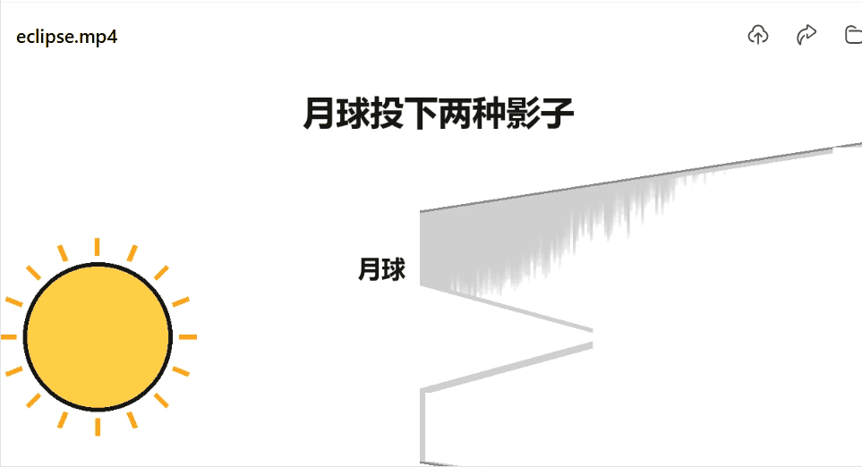

# whiteboard-explainer

白板讲解动画 skill。把讲解稿变成「真手绘过程」视频——图形一笔笔描出、文字逐笔写出、讲到哪画到哪（帧级音画对齐）。

> 本 skill 是**像素级笔画绘制**——帧帧确定、本地零成本、可秒级重渲，且支持"一图逐元素生长"的单画布模式（数学推导/流程图 友好）。

## 快速开始-安装使用

```bash
在workbuddy，codex, claude code，直接命令要求安装skill:https://github.com/liangdabiao/whiteboard-explainer
```

安装后，技能会在 workbuddy,Claude Code 、codex 中按学科关键词自动激活，也可手动调用。

例如： 利用 whiteboard-explainer skill 帮忙制作一个视频：  解释日全食

❯ whiteboard-explainer  ：英文教学制作  deepmind的故事

---

## Demo视频演示

B站demo演示： https://www.bilibili.com/video/BV1z4YW6UEER/



 
## 它能做什么 / 不能做什么

**能**：
- 一拍一图的 slide 模式，适合步骤讲解、产品介绍、教学课程。
- 一张大图逐元素生长的「单画布模式」，适合数学推导 / 流程图 / 知识图谱。
- 元素级 cue 对齐（"讲到哪画到哪"，旁白→绘制 帧级同步）。
- **5 套配色主题**（近白马克笔 / 暖纸 / 冷调 / 薄荷 / 樱粉），一键换底色换色系。
- 中文 / 英文 / 任意语种旁白（edge-tts，被墙时用 apiz）。
- 跨平台（macOS / Windows / Linux）。

**不能 / 注意**：
- 真人物 / 照片 / 复杂场景 → 用真人视频或别的 skill，白板风不合适。
- 8K / 超高清 → 引擎最大输出 1280 长边；要高清请在 final concat 步骤自己 upscale。
- Agnes 是付费 API（虽然免费档便宜），不放 key 时用 PIL 程序化绘制。
- **深色主题（黑板风）暂不支持** → 引擎把底色硬编码为纯白，浅色可成片后染色，深色需要自研渲染后端。
- **底色不能有渐变或噪点** → 会导致图形识别失败（详见下方「配色主题」）。

## 配色主题

内建 5 套主题，一行代码切换，绘图代码不用改任何一行：

```bash
python scripts/render_explainer.py plan.json --out out/x.mp4 --theme warm
```

| 主题 | 底色 | 适合 |
|---|---|---|
| `whiteboard` | `#F0F0F0` 近白 | 默认，原有观感，零回归风险 |
| `warm` | `#FBEDE3` 暖米 | 知识科普、书摘、温和耐看 |
| `cool` | `#EAF1FB` 冷蓝 | 技术 / 代码讲解，清爽克制 |
| `mint` | `#E7F4F3` 薄荷 | 轻量科普、生活类 |
| `sakura` | `#FBEBED` 樱粉 | 人文、情感、叙事 |

整批换肤用环境变量：`WHITEBOARD_THEME=cool python your_make_boards.py`

### 为什么底色只能是「灰度恰好 240 的纯色」

引擎把底色**三处硬编码为纯白 255**：

```
video_encoding.py:91     white = np.ones((h,w,3), np.uint8) * 255   # 空白帧
video_encoding.py:132    frame_buf = np.full((h,w,3), 255, ...)       # 主帧缓冲
video_encoding.py:178    255.0 + (color - 255.0) * a                 # 淡入混合底色
```

所以底色只存在于 PNG——PNG 阶段能通过连通域检查，但像素值进不了视频。
`lib/themed_render.py` 的解法是**成片后整体染色**：引擎照常渲白底线稿，
再把「接近纯白」的像素换成主题底色，浅色填充原样保留。不改 site-packages，引擎升级不受影响。

PNG 阶段另有更严的约束（决定图形能否被正确识别）：

| 底色灰度 | 引擎行为 |
|---|---|
| 235–239 | ✗ 底色与图形焊成全屏连通域，线条被吞 |
| **240** | ✓ 唯一可用值 |
| 241+ | 被刷成纯白，等于没换色 |

**不能用渐变**（跨过 240 即失效）、**不能加噪点**（±3 噪点产生 23606 个连通域，渲染直接失败）。

### 改主题前先体检

```bash
python lib/tools/check_theme.py      # 底色灰度 / 底色误判 / 文字碎裂 / 填充色
python lib/tools/pick_paper.py       # 求解并验证任意底色：pick_paper.py "#F0EADC"
python lib/tools/demo_themes.py      # 一张图看全部主题
```

体检会拦住一个容易踩的坑：**辅助文字色（`muted`）若与底色同色相且偏浅，小字会被二值化切碎**
（实测 `#8496A8` 配 `#EAF1FB` 让 30px 中文碎成 98 块）。所以 `muted` 一律灰度 ≲125 且色相与底色拉开。

## 制作流程与开发验证

- 用户确认与阶段拦截：[user-gates.md](references/user-gates.md)。
- 配音有效配置、内容缓存与运行清单：[narration-workflow.md](references/narration-workflow.md)。
- 视频缓存、G4/G5 类型化回执、教学设计与思考停顿：[render-workflow.md](references/render-workflow.md)。
- 开发测试只证明对应夹具与检查范围，不代替真实配音、白板绘制质量或用户完整观看确认。

## 文件结构

```
whiteboard-explainer/
├─ SKILL.md                     # 入口文档（AI agent 用这一份当系统 prompt）
├─ README.md                    # 你现在读的（人类开发者用这一份）
├─ LICENSE                      # MIT
├─ requirements.txt             # pip 依赖清单
├─ .gitignore
├─ assets/
│  └─ fonts/
│     ├─ MaShanZheng-Regular.ttf   # 毛笔字（OFL，差异化设计）
│     └─ OFL-MaShanZheng.txt       # 字体授权
├─ scripts/
│  ├─ setup.sh / setup.ps1     # 一键安装
│  ├─ self_test.py              # 自检（CRAFT/渲染/cue 对齐三关）
│  ├─ board_widgets.py          # 绘图组件库（54 个组件：人物/多边形/道具/结构图）
│  ├─ build_narration.py        # 子句 TTS + 精确 cue
│  ├─ build_narration_fast.py   # 同上，+22% 语速 + 裁静音（省 20% 时长）
│  ├─ render_explainer.py       # 主渲染（支持 --theme）
│  ├─ check_assignment.py       # 渲染前质检：每个组件都要归属到 region
│  ├─ autofix_boxes.py          # 批量修正 box
│  ├─ make_text_layer.py        # PIL 确定性中文文字层
│  ├─ gen_board_images.py       # Agnes 白板生图
│  ├─ gen_tts.py                # 复用脚本（旁白批量生成）
│  ├─ transcribe_align.py       # 音频转写 + 对齐
│  ├─ verify_media.py           # 成片校验
│  └─ slice_from_lrc.py         # 复用脚本（按 LRC 切片音频）
├─ lib/
│  ├─ theme.py                  # 主题表 + 底色求解 + ffmpeg 定位 + tpad 补丁
│  ├─ themed_render.py          # 成片底色染色（换主题的关键）
│  ├─ audit_boards.py           # 防重叠审计（深稿系列用）
│  ├─ lib_agnes.py               # Agnes HTTP 客户端（带重试）
│  └─ tools/
│     ├─ check_theme.py         # 主题体检
│     ├─ pick_paper.py          # 底色求解与验证
│     └─ demo_themes.py         # 五主题对比图
├─ vendor/
│  └─ ATTRIBUTION.md            # 第三方依赖归属（引擎/模型来源与许可）
├─ references/
│  ├─ pipeline.md               # 完整流水线（含踩坑记录）
│  ├─ region-plan-guide.md      # plan.build.json 写法详解
│  ├─ user-gates.md             # 硬性用户确认闸：风格 / 讲稿 / TTS / 冒烟
│  ├─ teaching-script.md        # 先稿后片：文章/教程 → 讲解视频（含确认闸）
│  ├─ concept-short-video.md    # 概念短视频系列七步管线
│  ├─ deep-fact-series.md       # 深度科普系列（含审计框架）
│  ├─ book-chapter-video.md     # 书籍章节系列
│  ├─ apiz-tts-fallback.md      # edge-tts 被403 时的旁白替代方案
│  └─ style-upgrade-proposal.md # 样式增强方案（frametell 对照研究）
└─ templates/
   ├─ region-plan.example.json  # 抄改起点
   └─ chart-recipes/
      └─ eclipse.py             # PIL 程序化绘制示范（影锥/轨道倾角/五阶段）
```

## 依赖与安装位置

| 依赖 | 类型 | 必须？ | 在哪 |
|---|---|---|---|
| `whiteboard-animator` | pip 包 | ✅ | PyPI `==0.1.1`（自带 CRAFT 模型，setup 自动安装） |
| `onnxruntime` | pip 包 | ✅ | PyPI |
| `edge-tts` | pip 包 | 可选 | PyPI；**本机已被微软 403 封锁，请改用 apiz**（见下） |
| `Pillow` / `numpy` | pip 包 | ✅ | PyPI |
| `ffmpeg` / `ffprobe` | 系统二进制 | ✅ | 内置配音与校验需要两者；ffmpeg 须支持 **libx264** |
| `AGNES_API_KEY` | Agnes API 凭证 | 可选 | `.env` 或环境变量 |

`.env` 寻找顺序：cwd → 父目录 → `~/.env` → `~/.workbuddy/.env`，找不到则硬报错（不会静默失败）。

详见 [`references/pipeline.md`](references/pipeline.md)。

### 旁白：edge-tts 被封时的替代方案（apiz）

**先获准再测试 edge-tts 是否可用**。G2 后准备单句 `preview.json`，按 G3 单独授权试听：

```bash
python scripts/gen_tts.py preview.json --preview --out-dir preview_audio
# 报 WSServerHandshakeError 403 → 已被封锁，走下面的 apiz 方案
```

出现 `WSServerHandshakeError 403` 时，换 **[apiz](https://apiz.ai/)**（NEX AI 模型网关，Apache-2.0，
提供官方 CLI / Python SDK / MCP server）。它不限流、有 300+ 音色，按量计费（1 积分 = 0.01 元）。

#### 安装与登录

```bash
# 一键安装（自动识别系统与架构）
curl -fsSL https://apiz.ai/cli | sh          # macOS / Linux
# Windows：scoop install apiz
# 或 brew install apiz-ai/tap/apiz

apiz auth login --api-key sk-...             # key 在 https://apiz.ai/#/api-keys 申请
apiz account balance                          # 查余额（余额不足会返回 429）
```

也支持环境变量 `APIZ_API_KEY`，或 `~/.config/apiz/config.toml` 存多个 profile。

#### 语音合成（本skill 唯一用到的能力）

```bash
# 列出全部音色（JSON，含 voice_id / voice_name / tags）
apiz voices list --json

# 合成并落盘
apiz speak "要合成的文本" \
  --model speech-2.6-turbo \       # 四档：2.8-hd / 2.8-turbo / 2.6-hd / 2.6-turbo
  --voice "Chinese (Mandarin)_Warm_Bestie" \
  --speed 1.22 \                   # 0.5–2.0，替代 edge-tts 的 rate="+22%"
  --output-file out/tts.mp3
```

讲解类音色：`Chinese (Mandarin)_Warm_Bestie`（温暖）/ `Chinese (Mandarin)_Gentleman`（温润男声）。
筛选中文音色看 `apiz voices list --json` 里的 `tags` 含「中文」。

> ⚠️ 用 `apiz speak` 子命令，**不要**用 `apiz generate --model minimax/t2a`——
> 后者走异步任务模型，只返回 `task_id` 且没有 `--out` 参数，拿不到音频文件。

#### 顺带一提：`apiz align` 能补词级时间戳

本skill 靠「每个 region 子句单独合成」拿到精确 cue（讲到哪画到哪）。
若你已有整段音频、只要对齐时间点，可直接用强制对齐：

```bash
apiz align "对应的文字" --audio https://example.com/talk.mp3
# 返回逐字毫秒时间戳 → 写进 plan.json 的 region.start/end
```

#### 完整可跑的替换脚本

见 [`references/apiz-tts-fallback.md`](references/apiz-tts-fallback.md)，
含 `build_voice.py` 完整源码：逐 region 合成 → 写回真实 start/end → concat 成每拍音轨。

### ffmpeg 兼容性

`lib/theme.py` 的 `ffmpeg_path()` 会按「支持 libx264」挑选可用的 ffmpeg，`setup_ffmpeg_env()` 负责注入 PATH。
遇到下面两种情况会自动兜底：

| 情况 | 表现 | 处理 |
|---|---|---|
| ffmpeg **缺 `tpad` 滤镜**（2016 老版本） | 渲染报 `No such filter: 'tpad'` | `patch_no_tpad()` 把绘制期拉满整段，绕过滤镜 |
| **没有 `ffprobe`** | 读不了音频时长 | `probe_duration()` 退回用 ffmpeg 解析 `Duration` |

手动指定路径：`render_explainer.py` 启动时会自动调用；也可直接改 `lib/theme.py` 的 `FFMPEG_CANDIDATES`。

## 典型踩坑（实测，均已验证）

| 现象 | 根因 | 处理 |
|---|---|---|
| 换 `board_widgets.py` 的配色，成片还是纯白 | 引擎 `frame_buf = np.full(..., 255)` 硬编码底色 | 底色只能成片后染色，用 `lib/themed_render.py` |
| 换成浅色底后，线条消失/画面被当色块涂满 | 底色灰度掉进 <240，与图形焊成全屏连通域 | 底色灰度必须**恰好 240** |
| 底色一加渐变或噪点就渲染失败 | 跨过 240 阈值 / 噪点炸出上万个连通域 | 底色只能是纯色，质感靠图形营造 |
| 小字被切成几十上百个碎块 | `muted` 与底色同色相且偏浅，二值化时断裂 | `muted` 灰度 ≲125 且色相与底色拉开 |
| `check_assignment` 报未归属，怎么改 box 都不变 | `BW.save()` 收的是**像素** `(x0,y0,x1,y1)`，内部才转归一化 | 写像素坐标；改完 board 要重跑 `build_narration` |
| `No such filter: 'tpad'` | 老版 ffmpeg 缺该滤镜 | `theme.patch_no_tpad()`（已自动调用） |
| 报找不到 `ffprobe` | 本机没装 | 自动退回 ffmpeg 解析时长 |
| edge-tts 报 403 | 微软按 IP/地区封锁（长期被封，非偶发） | 改用 `apiz speak`（见上方，需 apiz key） |
| `apiz generate` 建了任务却拿不到音频 | 用错子命令，走的是异步任务模型 | 必须用 `apiz speak --output-file`，它直接返回音频 |
| apiz 所有模型都报 429 余额不足 | 余额闸门（< 10 元时全部模型被拦） | `apiz account balance` 充值后立即恢复 |

## 协议

- **skill 本身**：MIT（见 `LICENSE`）
- **whiteboard-animator**：MIT（上游 [masihsultani/whiteboard-animator](https://github.com/masihsultani/whiteboard-animator)）
- **MaShanZheng-Regular.ttf**：SIL Open Font License 1.1（见 `assets/fonts/OFL-MaShanZheng.txt`）
- **CRAFT 模型**（craft.onnx）：Naver Clova AI Research，非商业用途

第三方归属与具体出处见 [`vendor/ATTRIBUTION.md`](vendor/ATTRIBUTION.md)。

## 致谢

- whiteboard-animator 引擎来自 [masihsultani/whiteboard-animator](https://github.com/masihsultani/whiteboard-animator) （MIT）
- 中文毛笔字体 [Ma Shan Zheng](https://fonts.google.com/specimen/Ma+Shan+Zheng) by Neural Reasoning
- 文字检测 [CRAFT](https://github.com/clovaai/CRAFT-pytorch) by Clova AI
- 配色主题系统参考了 [Frametell](https://github.com/sitor-ai/frametell) 的主题包设计
  （统一 palette 键名 + 可插拔 background 的思路；AGPL-3.0，本skill 仅借鉴架构思路，
  未复制其源码。详见 `references/style-upgrade-proposal.md`）
- linuxdo 社区支持 ： https://linux.do